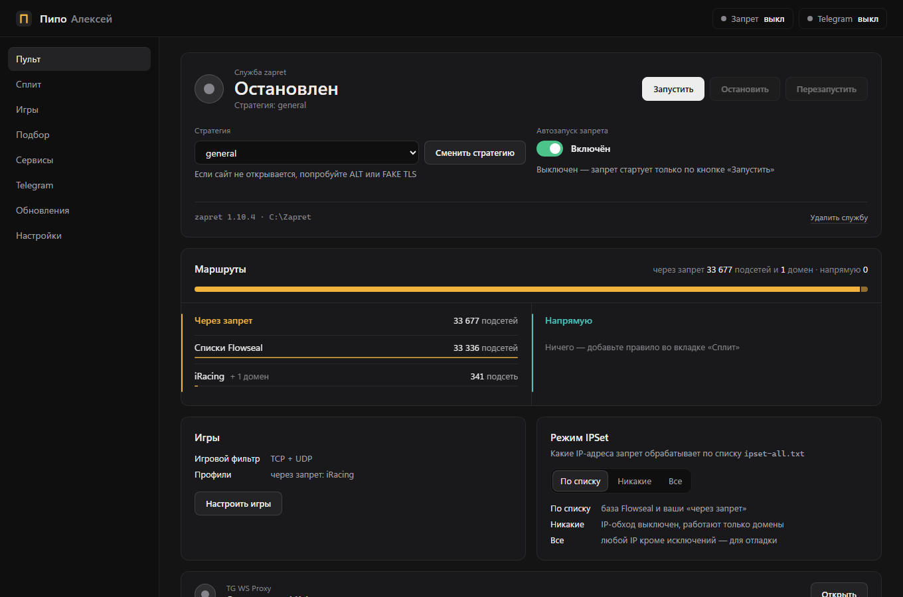
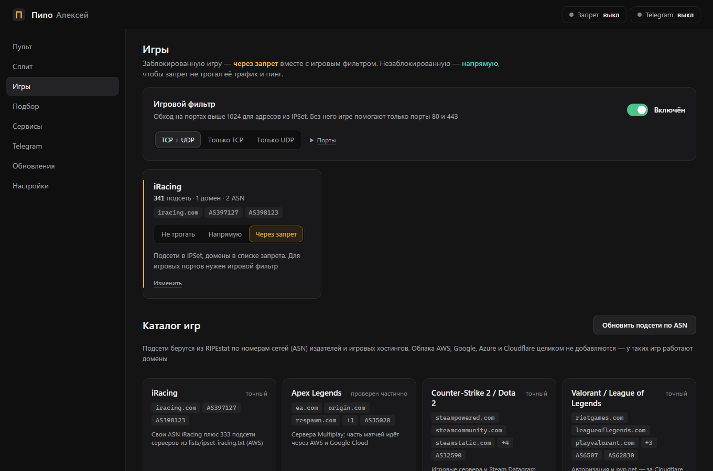
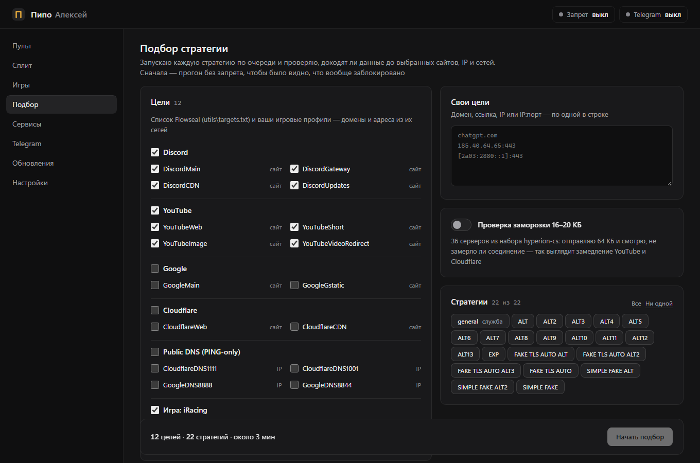
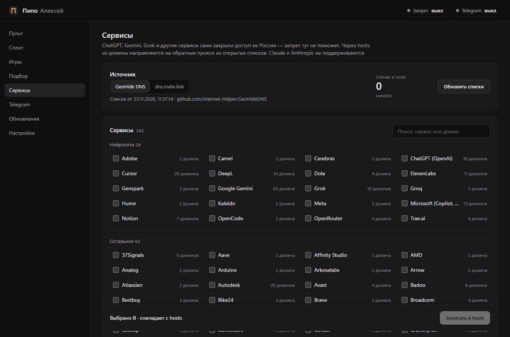

<div align="center">


# Пипо Алексей

Пульт для обхода блокировок на Windows: служба запрета, сплит «напрямую / через обход», игры, подбор стратегии и Telegram-прокси в одном окне

</div>

> [!IMPORTANT]
> **Пипо Алексей — это не запрет и не его форк.** Это графическая оболочка, которая управляет уже установленными у вас
> [zapret-discord-youtube](https://github.com/Flowseal/zapret-discord-youtube) от Flowseal,
> [zapret2-discord-youtube-strats](https://github.com/kinlay0/zapret2-discord-youtube-strats) от kinlay0 и
> [TG WS Proxy](https://github.com/Flowseal/tg-ws-proxy). Сам обход DPI делает `winws.exe` из проекта
> [zapret](https://github.com/bol-van/zapret) или `winws2.exe` из [zapret2](https://github.com/bol-van/zapret2) (bol-van). Программы этих авторов здесь не распространяются:
> приложение работает с вашей папкой запрета и скачивает обновления с их официальных страниц на GitHub.



## Что умеет

- **Два движка.** zapret (сборка Flowseal) или zapret2 (сборка kinlay0) — переключатель на пульте. Работает один из двух: служба и драйвер WinDivert у них общие. Сплит, игры и игровой фильтр переезжают вместе с движком, у каждого движка запоминается своя стратегия и свой результат подбора.
- **Пульт.** Запуск и остановка службы запрета, выбор стратегии (`general*.bat`), тумблер автозапуска (по умолчанию выключен), режим IPSet. Схема маршрутов показывает, сколько подсетей и доменов идёт через обход, а сколько напрямую.
- **Сплит.** Домен, ссылка, IP или подсеть — «напрямую» или «через запрет». Незаблокированным сайтам обход не нужен. GeoIP-правило отправляет целую страну напрямую; заблокированное из списков Flowseal из неё автоматически вычитается.
- **Игры.** Тумблер игрового фильтра (TCP + UDP / TCP / UDP) и профили игр: «через запрет», «напрямую» или «не трогать». Каталог из 19 игр с доменами и сетями серверов по ASN (подсети подтягиваются из RIPEstat): CS2/Dota 2, Valorant/LoL, Apex, Fortnite, PUBG, Battlefield, CoD, Overwatch, Tarkov, Roblox, iRacing и другие. Можно добавить свою игру.
- **Подбор стратегии.** По очереди запускает стратегии и проверяет выбранные цели: сайты (TLS 1.2 и 1.3), ваши IP и сети игр, заморозку 16–20 КБ (набор [hyperion-cs/dpi-checkers](https://github.com/hyperion-cs/dpi-checkers)). Сначала прогон без запрета — видно, что заблокировано и что именно чинит каждая стратегия. Лучшая применяется одной кнопкой.
- **Эволюция стратегий (zapret2).** Приложение само ищет обход под вашего провайдера: стратегия для TLS — цепочка шагов (фейки, разрезание пакета, способ обмана DPI), готовые стратегии сборки становятся первым поколением, лучшие скрещиваются и мутируют, каждый вариант проверяется на ваших целях. Рассчитано на ночь: компьютер не уснёт, пропавший интернет не испортит результат, поиск можно продолжить. Найденное сохраняется как `general (PIPO EVO N).bat` и применяется одной кнопкой.
- **Диагностика.** Подменяет ли провайдер DNS: ответы обычного DNS сравниваются с DoH/DoT, находится адрес заглушки и перехват запросов к 8.8.8.8/1.1.1.1, показываются шифрованные DNS-серверы, которые у вас работают.
- **Сервисы.** Нейросети и сервисы, которые сами закрыли доступ из России (ChatGPT, Gemini, Grok, Copilot и другие), через hosts и обратные прокси [GeoHide DNS](https://github.com/Internet-Helper/GeoHideDNS) или [dns.malw.link](https://github.com/ImMALWARE/dns.malw.link). Правила пишутся отдельным блоком, исходный hosts сохраняется, всё откатывается одной кнопкой.
- **Telegram.** Запуск TG WS Proxy, ссылка `tg://proxy` для Telegram Desktop, автозапуск.
- **Трей.** Значок у часов: правой кнопкой включить или выключить запрет и прокси Telegram, не открывая окно. Крестик прячет окно в трей, «Выход» в меню значка закрывает программу. Правая кнопка по лампам «Запрет» и «Прокси TG» вверху окна делает то же самое.
- **Гайд и масштаб.** При первом запуске гайд проводит по всем вкладкам; повторить можно в «Настройках». На весь экран контент держится по центру, масштаб интерфейса (90–140%) задаётся в «Настройках».
- **Обновления.** Проверка версий запрета, zapret2 и TG WS Proxy; zapret2 можно установить отсюда же, не останавливая работающий запрет. Новая версия скачивается только после подтверждения, сверяется по sha256, перед установкой делается бэкап; ваши списки и настройки сохраняются.

| Игры | Подбор стратегии | Сервисы |
| --- | --- | --- |
|  |  |  |

## Установка

1. Установите [zapret-discord-youtube](https://github.com/Flowseal/zapret-discord-youtube/releases) от Flowseal, например в `C:\Zapret` (другую папку можно указать в «Настройках»). zapret2 ставится по желанию из вкладки «Обновления» в `C:\Zapret2`.
2. Скачайте `PipoAlexey.exe` со страницы [Releases](../../releases) и запустите. Windows попросит права администратора — без них нельзя управлять службой и писать списки.

Данные приложения (сплит, кеши, бэкапы, лог) лежат в папке `data` рядом с exe. Нужна Windows 10/11 с WebView2 (в Windows 11 он встроен).

Антивирусы иногда ложно реагируют на программы, собранные PyInstaller. Исходный код открыт — можно собрать exe самостоятельно.

## Важно знать

- Запрет меняет только то, как выглядит ваш трафик для DPI провайдера. Он не прячет IP и не шифрует данные.
- Раздел «Сервисы» направляет запросы к выбранным сервисам через чужие прокси-серверы. Их владельцы видят, к какому сервису и с какого IP вы обращаетесь (содержимое HTTPS — нет). Это обход ограничений самих сервисов: их правила такое запрещают, аккаунт могут заблокировать.
- **Claude и сервисы Anthropic не поддерживаются намеренно** — их домены отбрасываются при разборе любого списка.

## Сборка из исходников

Нужны Python 3.14, Node.js и [Rust](https://rustup.rs) с Visual Studio Build Tools (компонент «Разработка классических приложений на C++»).

```bat
python -m venv .venv
.venv\Scripts\python.exe -m pip install fastapi uvicorn pywebview pyinstaller
build_exe.bat
```

Результат — `dist\PipoAlexey.exe`. Внутри два слоя: окно и значок в трее на [Tauri](https://tauri.app) (`desktop/`) и Python-сервер со всей логикой (`main.py`, `app/`), который собирается PyInstaller в `pipo-server.exe` и вшивается в окно. Без Rust `build_exe.bat` соберёт прежнее окно на pywebview, без трея.

Для разработки: `start.bat` запускает приложение из исходников в окне pywebview, `cargo run` в папке `desktop` — в окне Tauri с треем (сервер берётся из `.venv`, без прав администратора). Фронтенд (React + Vite) лежит в `frontend/`.

Тесты: `.venv\Scripts\python.exe -m unittest discover -s tests -t .`

UI-тесты (Playwright, в установленном Edge): `npm run test:ui` в папке `frontend`. API в них подменяется фикстурами из `frontend/tests/ui/fixtures.json`, так что ни сервер, ни права администратора, ни сам запрет не нужны.

## Благодарности

- [Flowseal](https://github.com/Flowseal) — [zapret-discord-youtube](https://github.com/Flowseal/zapret-discord-youtube) и [tg-ws-proxy](https://github.com/Flowseal/tg-ws-proxy)
- [bol-van](https://github.com/bol-van) — [zapret](https://github.com/bol-van/zapret) и [zapret2](https://github.com/bol-van/zapret2)
- [kinlay0](https://github.com/kinlay0) — [zapret2-discord-youtube-strats](https://github.com/kinlay0/zapret2-discord-youtube-strats)
- [hyperion-cs](https://github.com/hyperion-cs/dpi-checkers) — тест заморозки 16–20 КБ
- [Runnin4ik](https://github.com/Runnin4ik/dpi-detector) — методика и списки серверов для проверки DNS
- [GeoHide DNS](https://github.com/Internet-Helper/GeoHideDNS) и [dns.malw.link](https://github.com/ImMALWARE/dns.malw.link) — списки hosts
- [ipverse](https://github.com/ipverse/country-ip-blocks) — диапазоны стран, [RIPEstat](https://stat.ripe.net) — сети по ASN

## Лицензия

[MIT](LICENSE). Лицензия относится к коду этого репозитория; запрет, zapret2, сборки стратегий, TG WS Proxy и списки hosts распространяются их авторами на их собственных условиях.
